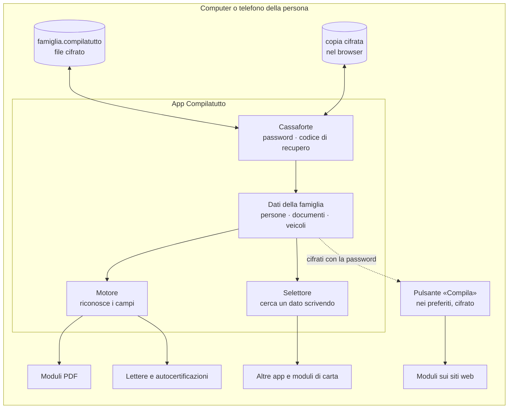

# Architettura di Compilatutto

Compilatutto custodisce i dati di una famiglia e li usa per riempire moduli: siti web, PDF, lettere, app. Tre regole guidano ogni scelta:

1. **I dati non lasciano il dispositivo.** Nessun server, nessun account, nessuna statistica. L'app è fatta di file statici: chi la ospita (GitHub Pages o altro) consegna solo il programma, mai i dati.
2. **I dati sono sempre cifrati quando sono salvati.** Nel file sul computer, nella copia nel browser, nel pulsante «Compila». In chiaro esistono solo in memoria, dopo aver scritto la password.
3. **Un solo archivio, tanti modi di usarlo.** La cassaforte è una sola; i «connettori» (pulsante per i siti, PDF, lettere, cerca e copia) leggono da lì.



## 1. Cassaforte

| Cosa | Come |
|---|---|
| Cifratura dei dati | AES-GCM a 256 bit con una **chiave dati** casuale; ogni salvataggio usa un vettore iniziale nuovo |
| Password | Dalla password si ricava, con PBKDF2-SHA256 e 600.000 ripetizioni, la chiave che «chiude» la chiave dati |
| Codice di recupero | 32 caratteri casuali creati all'inizio; chiudono una seconda copia della chiave dati. Serve se la password si dimentica |
| File sul computer | `famiglia.compilatutto` (testo JSON con dati cifrati). Con Chrome ed Edge su computer l'app lo aggiorna da sola a ogni modifica; con gli altri browser si scarica una copia nuova |
| Copia nel browser | La stessa cassaforte cifrata, nel localStorage, per non dover riaprire il file ogni volta |
| Blocco automatico | Dopo alcuni minuti senza usare l'app (5, 10 o 30) i dati in chiaro vengono tolti dalla memoria |

Cambiare password non ricifra i dati: si richiude solo la chiave dati con la nuova password. Senza password e senza codice di recupero i dati **non si possono recuperare**, nemmeno da chi ha scritto l'app.

Formato del file:

```json
{
  "formato": "compilatutto-cassaforte",
  "versione": 2,
  "modificato": "2026-10-17T10:42:00Z",
  "chiavi": [
    { "tipo": "password", "kdf": "PBKDF2-SHA256", "ripetizioni": 600000, "sale": "…", "iv": "…", "chiave": "…" },
    { "tipo": "recupero", "kdf": "PBKDF2-SHA256", "ripetizioni": 100000, "sale": "…", "iv": "…", "chiave": "…" }
  ],
  "contenuto": { "iv": "…", "dati": "…" }
}
```

## 2. Dati della famiglia

```
famiglia
├── persone[]          io, coniuge, figli, padre, madre, altre persone
│   ├── anagrafica     nome, cognome, sesso, nascita, codice fiscale, cittadinanza, stato civile
│   ├── genitori       nome e cognome di padre e madre (se non sono nella famiglia)
│   ├── residenza      e domicilio se diverso
│   ├── contatti       cellulare, fisso, email, PEC
│   ├── documenti      carta d'identità, passaporto, patente, tessera sanitaria, permesso di soggiorno
│   ├── lavoro, scuola, banca, salute
│   └── altri dati     scelti dalla persona (nome, valore, parole chiave)
└── veicoli[]          targa, marca, modello, telaio, immatricolazione, assicurazione, revisione, bollo, proprietario
```

L'elenco dei campi e delle parole con cui i moduli li chiamano sta in [`app/campi.js`](../app/campi.js). Aggiungere un dato significa aggiungere una riga lì.

## 3. Motore

[`app/motore.js`](../app/motore.js) guarda ogni campo di un modulo e decide **quale dato** e **di quale persona**.

1. **Indizi del campo**: etichetta, testo vicino (anche nelle tabelle), segnaposto, nome tecnico, attributo `autocomplete`.
2. **Contesto**: la sezione del modulo («Dati del coniuge», «Dati dell'alunno», «Domicilio», «Passaporto»).
3. **Dato**: confronto con le parole di `campi.js`; vince la frase più lunga e precisa.
4. **Persona**: «coniuge», «figlio», «padre», «madre», «genitore» sono letti rispetto a chi compila. Se compila il figlio, «padre» e «madre» sono i genitori presenti nella famiglia.
5. **Regole di vicinato**: «Via ___ n. ___», «Nato a ___ Prov. ___ il ___», «Rilasciato da ___ il ___».
6. **Valore adatto al campo**: data nel formato richiesto, sigla della provincia, voce giusta dei menu, telefono senza prefisso se il campo è corto.

Il motore non preme mai «Invia». I campi riempiti diventano verdi, quelli da fare a mano gialli. Quelli di altre persone (delegato, tutore, contatto di emergenza…) restano vuoti.

## 4. Connettori

| Dove | Come | Stato |
|---|---|---|
| Siti web, sul computer e su Android | Pulsante «Compila» nei preferiti. Contiene i dati **cifrati**: quando lo tocchi chiede la password, poi compila. Dopo, toccando un campo si apre il **selettore** | fatto |
| PDF compilabili | Si aprono nell'app: i campi vengono riconosciuti e riempiti, gli altri si scelgono dal selettore, poi si salva il PDF compilato. Tutto avviene sul dispositivo | fatto |
| PDF non compilabili | Istruzioni per Edge («Aggiungi testo»), Acrobat Reader («Compila e firma») e Android, con «Cerca e copia» accanto | istruzioni |
| Lettere, Word, autocertificazioni | Segnaposti `[NOME PADRE]` e spazi `nato a ______`; copia con formattazione o file per Word | fatto |
| App, programmi, moduli di carta | «Cerca e copia»: scrivi «targa», «scadenza passaporto», «Lucia codice fiscale» e copi il valore | fatto |
| Estensione per Chrome, Edge, Firefox | Come il pulsante, ma con menu col tasto destro «Inserisci dato» e senza dover riscrivere la password a ogni pagina | da fare |
| App Android con «servizio di compilazione automatica» | Riempie i campi in tutte le app del telefono, come fanno i gestori di password | da fare |
| Scrivere sopra i PDF non compilabili | Mostrare la pagina, toccare il punto e scegliere il dato | da fare |

## 5. Selettore dati

Lo stesso componente serve sulla pagina web, nei PDF e in «Cerca e copia». Mostra tutti i dati di tutte le persone e dei veicoli; scrivendo poche lettere si filtra («pass sca» trova *Passaporto · Scadenza*). Ogni voce dice di chi è il dato.

## 6. Sicurezza: cosa protegge e cosa no

- **Protegge** da chi trova il file, il computer spento, i preferiti sincronizzati online o la copia nel browser: senza password vede solo dati cifrati.
- **Non protegge** da un computer già infettato da programmi spia, né dal sito su cui compili: quel sito riceve i dati che inserisci (è lo scopo), e sulla sua pagina viene scritta anche la password del pulsante. Usa il pulsante solo sui siti di cui ti fidi.
- La pagina «Siti web» rifiuta le pagine non protette (`http://`).
- Il codice dell'app non usa risorse esterne. La libreria per i PDF ([pdf-lib](https://pdf-lib.js.org), licenza MIT) è inclusa nell'app.

## 7. Struttura dei file

```
app/
  index.html, stile.css     interfaccia
  campi.js                  dati, parole dei moduli, province
  cassaforte.js             cifratura, file sul computer, copia nel browser
  motore.js                 riconoscimento e compilazione (diventa il pulsante)
  pulsante.js               sblocco con password sulla pagina del modulo
  moduli-pdf.js             compilazione dei PDF
  app.js                    schermate e comandi
  lib/pdf-lib.min.js        libreria PDF
  sw.js, manifest           app installabile e utilizzabile senza rete
test/                       prove automatiche in Chromium e moduli di esempio
```
